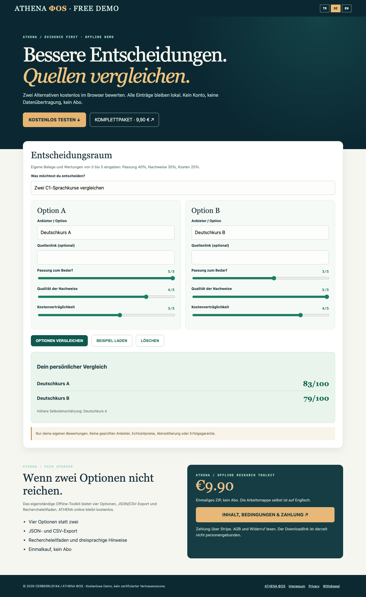

# ATHENA ΦOS | Offline Decision Toolkit

**Decision matrix guide (English):** [Read the worked example and compare free versus paid](https://charlysmoky2010-hub.github.io/athena-offline-decision-toolkit/decision-matrix.html). Optional translations: [Deutsch](https://charlysmoky2010-hub.github.io/athena-offline-decision-toolkit/entscheidungshilfe-de.html) · [Türkçe](https://charlysmoky2010-hub.github.io/athena-offline-decision-toolkit/karar-matrisi-tr.html).

**Free interactive demo:** [Try the 2-option decision calculator](https://charlysmoky2010-hub.github.io/athena-offline-decision-toolkit/)

ATHENA is a privacy-first research companion. The free demo compares **two options**, locally in your browser, using user-defined evidence scores. No signup, tracking, subscription, API keys, or external data upload.

**Complete offline toolkit: €9.90 one-time:** [View the product details, consumer terms and Stripe checkout](https://charlysmoky2010-hub.github.io/athena-offline-decision-toolkit/offline-toolkit.html)

The complete downloadable ZIP includes a **four-option** comparison workbook, local **JSON and CSV exports**, a reusable research playbook, and Turkish, German and English instructions. The workbook interface itself is currently English.

| Feature | Free demo | Offline toolkit €9.90 |
|---|---|---|
| Local browser-based comparison | 2 options | 4 options |
| Weighted need/evidence/cost criteria | Yes | Yes |
| Evidence pack in JSON | No | Yes |
| Spreadsheet-friendly CSV | No | Yes |
| Research playbook | No | Yes |
| Subscription | None | None |

**How to use it:** Describe two courses, job offers, software providers or other options; enter a score from 0 to 5 for fit, source evidence and cost suitability. ATHENA computes **40% fit, 35% evidence, 25% cost**. These are personal, editable judgement scores, NOT verified seller ratings or live prices. No payment is made from the demo.

**Languages:** The English landing page provides optional DE and TR language controls. The paid workbook's interface is in English, with guidance in three languages. The free [ATHENA ΦOS online search beta](https://abstract-veil-376mcyt.shipstatic.com/) is separately available without payment.

**Privacy:** The standalone demo performs no network requests, does not set cookies and does not retain your personal information when closed. External links open only when clicked. Do not input sensitive financial or health information into external third-party searches.

**Legal and consumer information:** [Impressum](https://vlgibwclecuhnnrgycnx.supabase.co/functions/v1/phi-nexus-public?page=imprint&locale=de) · [Privacy](https://vlgibwclecuhnnrgycnx.supabase.co/functions/v1/phi-nexus-public?page=privacy&locale=de) · [Terms](https://vlgibwclecuhnnrgycnx.supabase.co/functions/v1/phi-nexus-public?page=terms&locale=de) · [Withdrawal information](https://vlgibwclecuhnnrgycnx.supabase.co/functions/v1/phi-nexus-public?page=withdrawal&locale=de).

The product is a personal decision aid. It is not a certified trust score, live price checker, scientific physics solver, or promise of income. The full toolkit uses a shareable post-payment download link, not a buyer-specific encrypted entitlement. No end-to-end paid customer transaction has been verified.

**CERBERRUS144 / ATHENA ΦOS.** This public repository does not include private CERBERRUS code, customer information, secret credentials, or the paid ZIP.
